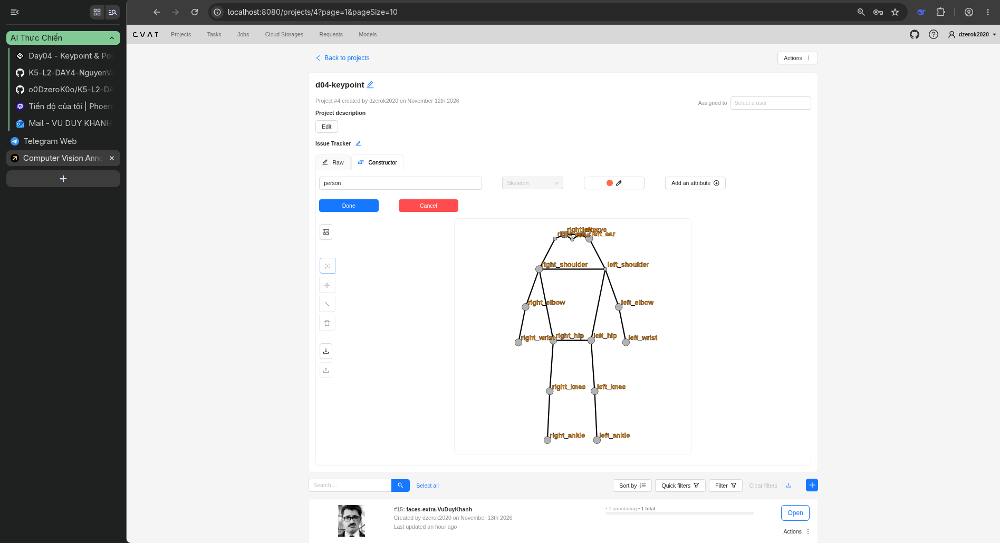
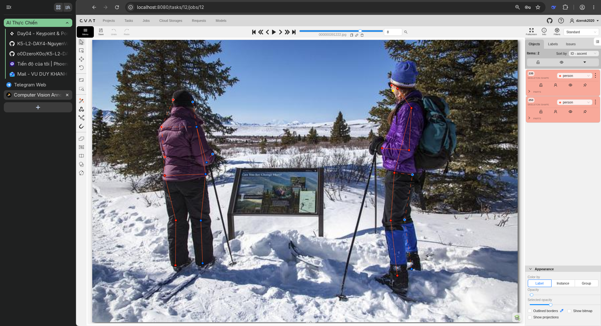
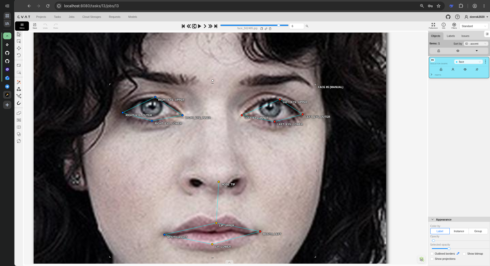
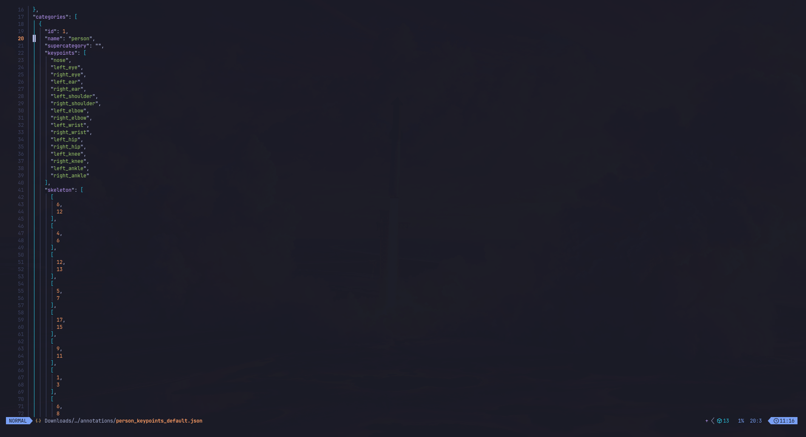

# Báo cáo cá nhân — HoVaTen-MSSV

Đổi tên file theo quy tắc `MSSV_HoTen.md`. Ví dụ: `20241234_NguyenVanAn.md`.

Dữ liệu: 12 ảnh người COCO val2017 (Lin et al., 2014) và 8 ảnh chân dung Wikimedia Commons, chỉ dùng trong lớp.

## 0. Thông tin học viên

- Họ tên: VŨ DUY KHANH
- MSSV: 2A202603142
- Email: 26ai.khanhvd@vinuni.edu.vn
- Link repository: https://github.com/o0DzeroK0o/K5-L2-DAY04-VuDuyKhanh-2A202603142-KeypointPose
- Phiên bản CVAT (Help → About): 2.82.1
- Máy: hệ điều hành Linux · RAM 32 GB · chạy CVAT chế độ đầy đủ
- Bộ ảnh (`src/exports/assignment.json` do `lab.py setup` tạo): có
- Giờ bắt đầu: 16:30 12/11/2026
- Giờ kết thúc: 19:00 12/11/2026

## 1. Kiểm tra label (CP0)

| Label    | Kiểu     | Số điểm | Tên điểm đúng bảng của lab? | Đúng thứ tự? | Số cạnh |
| -------- | -------- | ------: | --------------------------- | ------------ | ------: |
| `person` | Skeleton |      17 | Đúng                        | Đúng         |      19 |
| `face`   | Skeleton |      13 | Đúng                        | Đúng         |      13 |

Mẫu `person` dựng theo người quay mặt về camera (các điểm `left_*` nằm bên phải khung mẫu)? Có

Cách đổi cờ `occluded` / `outside` cho **một điểm** trên phiên bản CVAT này (một câu):

- `occluded`: Chọn điểm bấm vào nút switch occluded property hoặc phím Q
- `outside`: Chọn điểm bấm vào nút switch outside property hoặc phím O

## 2. Số lượng đã gán và thời gian (CP1, CP2)

| Nhóm ảnh   | Số ảnh | Số skeleton đã gán | Số người dưới 60 px (không gán) | Số poster / gương / màn hình bỏ qua | Thời gian (phút) |
| ---------- | -----: | -----------------: | ------------------------------: | ----------------------------------: | ---------------: |
| `easy`     |      5 |                  5 |                               0 |                                   0 |                  |
| `occluded` |      3 |                  6 |                               0 |                                   0 |                  |
| `back`     |      3 |                  7 |                               0 |                                   0 |                  |
| `small`    |      1 |                  2 |                               5 |                                   0 |                  |
| `crowd`    |      3 |                  9 |                               2 |                                   0 |                  |
| `faces`    |     13 |                 13 |                               0 |                                   0 |                  |

- Số ảnh người đã xong ở mốc phút 105: 10 / 10
- Thời gian thực tế (phút): CP1 80 · CP2 30 · CP3 20
- Ảnh tốn thời gian nhất là ảnh nào, vì sao? Ảnh 000000517702.jpg tốn nhiều thời gian vì có 3 người, hai người phía trước bị ô che phần đầu, người phía sau bị cắt khỏi khung hình; cần kiểm tra kỹ vị trí và trạng thái các keypoint.

## 3. Bảng ca khó (CP1, CP2)

Mỗi điểm bạn phân vân một dòng, nhất là phân vân giữa `v = 1` và `v = 0`, hoặc không chắc hướng người.

| Ảnh                | Người / mặt                       | Điểm              | Cờ đã chọn | Phân vân giữa               | Lý do chọn                                                                    |
| ------------------ | --------------------------------- | ----------------- | ---------: | --------------------------- | ----------------------------------------------------------------------------- |
| `000000109010.jpg` | Người mặc đồ đen bên trái         | `left_wrist`      |          1 | `v=1` và `v=0`              | Cổ tay bị che nhưng có thể ước lượng vị trí dựa vào cẳng tay.                 |
| `000000179201.jpg` | Người ngồi bên trái               | `left_knee`       |          0 | `v=1` và `v=0`              | Phần chân bị bàn che, không xác định đáng tin cậy vị trí đầu gối.             |
| `000000179201.jpg` | Người ngồi bên phải, trước laptop | `right_wrist`     |          1 | `v=1` và `v=0`              | Cổ tay bị che một phần, còn có thể suy ra vị trí từ hướng cánh tay.           |
| `000000391222.jpg` | Người bên trái, quay lưng         | `nose`            |          0 | `v=1` và `v=0`              | Mặt quay khỏi camera, không đủ căn cứ đặt điểm mũi.                           |
| `000000391222.jpg` | Người bên trái, quay lưng         | `left_hip`        |          2 | Bên trái và bên phải cơ thể | Xác định bên theo cơ thể; khi quay lưng, bên trái cơ thể nằm phía trái ảnh.   |
| `000000480582.jpg` | Người bên trái, quay lưng         | `left_knee`       |          1 | `v=1` và `v=0`              | Đầu gối bị trang phục che, có thể ước lượng theo trục chân và tư thế đứng.    |
| `face_146049.jpg`  | Mặt đeo kính râm                  | `left_eye_outer`  |          1 | `v=1` và `v=0`              | Kính che đuôi mắt; chọn vị trí ước lượng theo vùng mắt và cấu trúc khuôn mặt. |
| `face_146049.jpg`  | Mặt đeo kính râm                  | `right_eye_inner` |          1 | `v=1` và `v=0`              | Khóe mắt bị kính che nhưng có thể ước lượng tương quan với sống mũi.          |
| `face_196742.jpg`  | Mặt người cầm micro               | `lip_lower`       |          1 | `v=1` và `v=0`              | Micro che phần môi dưới, vị trí được ước lượng dựa vào phần miệng còn thấy.   |
| `face_469647.jpg`  | Mặt có tóc che mắt                | `right_eye_outer` |          1 | `v=1` và `v=2`              | Tóc che khóe mắt ngoài, nên đánh dấu bị che thay vì nhìn thấy rõ.             |
## 4. Bảng tự review (CP3)

Đi từ ảnh cuối về ảnh đầu. 5 ảnh người (ít nhất 2 ảnh `back` hoặc `crowd`) và 3 ảnh mặt. Ít nhất 8 dòng, kể cả dòng `ok`. Ghi lỗi trước, sửa sau.

Mã lỗi dùng đúng một trong: `lr_swap`, `vis_flag`, `position`, `missing`, `extra`, `ok`.

| Ảnh                | Người / mặt                                      | Điểm              | Mã lỗi     | Ghi chú                                                                                                                   | Đã sửa?   |
| ------------------ | ------------------------------------------------ | ----------------- | ---------- | ------------------------------------------------------------------------------------------------------------------------- | --------- |
| `000000572411.jpg` | Người mặc áo xám, bên trái người áo trắng đã gán | `nose`            | `vis_flag` | Đang là `v=1`, nhưng vùng mặt và mũi không bị vật khác che. Nên phóng to kiểm tra và đổi sang `v=2` nếu nhận rõ điểm mũi. | chưa      |
| `000000480582.jpg` | Người bên trái, quay lưng                        | `left_knee`       | `ok`       | Đang là `v=1`: đầu gối bị cừu che, có thể ước lượng theo hướng chân.                                                      | Không cần |
| `000000433787.jpg` | Người chèo ván                                   | `right_ankle`     | `ok`       | Điểm nằm tại vùng cổ chân phải; cờ `v=2` phù hợp với phần nhìn thấy.                                                      | Không cần |
| `000000391222.jpg` | Người bên trái, quay lưng                        | `left_hip`        | `ok`       | Không thấy đảo trái/phải tại điểm này: hông trái cơ thể nằm phía trái ảnh khi quay lưng.                                  | Không cần |
| `000000326480.jpg` | Người phụ nữ đứng giữa                           | `left_elbow`      | `ok`       | Đang là `v=1`: khuỷu tay bị người bên phải che, vị trí ước lượng phù hợp với hướng cánh tay.                              | Không cần |
| `face_575921.jpg`  | Mặt người đàn ông cầm điện thoại                 | `right_eye_inner` | `position` | Điểm có dấu hiệu lệch khỏi khóe mắt vào phía sống mũi; cần đưa sát vị trí hai mí mắt gặp nhau.                            | Đã sửa    |
| `face_562485.jpg`  | Mặt người phụ nữ tóc xoăn                        | `mouth_left`      | `ok`       | Điểm nằm gần khóe miệng trái của nhân vật, phía phải ảnh; không thấy đảo bên.                                             | Không cần |
| `face_469647.jpg`  | Mặt người phụ nữ có tóc che mắt                  | `right_eye_outer` | `ok`       | Đang là `v=1`: tóc che khóe mắt ngoài, còn có thể ước lượng từ phần mắt nhìn thấy.                                        | Không cần |
Tổng hợp số lỗi theo mã:

| `lr_swap` | `vis_flag` | `position` | `missing` | `extra` | `ok` |
| --------: | ---------: | ---------: | --------: | ------: | ---: |
|         0 |          1 |          1 |         0 |       0 |    6 |

Điểm còn phân vân giữa `v = 1` và `v = 0` (ghi cả hai lựa chọn và lý do chọn):

| Ảnh — người                            | Điểm              | Lý do                                                                                       |
| -------------------------------------- | ----------------- | ------------------------------------------------------------------------------------------- |
| `000000480582.jpg` — người bên trái    | `left_knee`       | Có thể suy ra tương đối từ trục đùi, phần chân còn thấy và tư thế đứng.                     |
| `000000391222.jpg` — người bên trái    | `left_wrist`      | Cổ tay không thấy rõ, hướng cẳng tay chưa đủ chắc để đặt điểm.                              |
| `face_469647.jpg` — mặt có tóc che mắt | `right_eye_outer` | Nếu phần mí mắt còn thấy đủ để xác định khóe mắt; tránh đặt chỉ dựa vào đối xứng khuôn mặt. |

## 5. Kiểm file xuất và kết quả tự kiểm (CP4)

Tự kiểm tay trong file JSON:

| File                     | Người / mặt kiểm (ảnh, thứ tự)                                | Số phần tử `keypoints` | Điểm `outside` ra `v = 0`, `occluded` ra `v = 1`?                        | `num_keypoints` khớp?                 |
| ------------------------ | ------------------------------------------------------------- | ---------------------: | ------------------------------------------------------------------------ | ------------------------------------- |
| `VuDuyKhanh_persons.zip` | `000000109010.jpg` — người mặc vest bên phải, annotation ID 1 |                     51 | Có: hai cổ chân `v=0`, tai trái `v=1`                                    | Có: **15 = 14 điểm v=2 + 1 điểm v=1** |
| `VuDuyKhanh_persons.zip` | `000000179201.jpg` — người ngồi bên trái, annotation ID 8     |                     51 | Có: sáu điểm phần thân dưới `v=0`; tai phải, vai trái, cổ tay trái `v=1` | Có: **11 = 8 điểm v=2 + 3 điểm v=1**  |
| `VuDuyKhanh_faces.zip`   | `face_146049.jpg` — mặt duy nhất, annotation ID 2             |                     39 | Tám điểm mắt bị kính che có `v=1`; mặt này không có điểm `v=0`           | Có: **13 = 5 điểm v=2 + 8 điểm v=1**  |
Sau khi xuất, CVAT ghi `occluded` thành `v = 1` và `outside` thành `v = 0`. Tọa độ của điểm `outside` trong file là `0, 0` hay tọa độ cũ? Điểm `outside` **vẫn giữ tọa độ cũ**, không tự chuyển thành `0, 0`.

Hai job đã chuyển sang completed trên CVAT? Có 

Dán phần **TÓM TẮT** in ra từ `src/check_submission.py`:

```text
----- TÓM TẮT (dán vào báo cáo mục 5) -----
- File person: VuDuyKhanh_persons.zip
  Số ảnh: 12 · số skeleton `person`: 20 · mỗi annotation 51 số
  Skeleton theo ảnh: 000000109010=2, 000000137767=1, 000000156986=2, 000000162046=1, 000000164659=1, 000000179201=2, 000000292999=1, 000000326480=3, 000000391222=2, 000000433787=1, 000000480582=2, 000000572411=2
  Cờ v: v=2 214 (63%) · v=1 87 (26%) · v=0 39 (11%)
  num_keypoints trung bình: 15.1
- File face: VuDuyKhanh_faces.zip
  Số ảnh: 8 · số skeleton `face`: 8 · mỗi annotation 39 số
  Skeleton theo ảnh: face_105668=1, face_146049=1, face_196742=1, face_3348=1, face_449454=1, face_469647=1, face_562485=1, face_575921=1
  Cờ v: v=2 94 (90%) · v=1 10 (10%) · v=0 0 (0%)
  num_keypoints trung bình: 13.0
- Ghi chú: 39 điểm v = 0 vẫn mang tọa độ cũ (CVAT 2.x xuất như vậy; chuẩn COCO ghi 0, 0). Không phải lỗi: điểm v = 0 bị bỏ qua khi huấn luyện và khi chấm.
- Số [LỖI]: 0 · số [CẢNH BÁO]: 3
Kết quả: ĐẠT (đọc lại từng cảnh báo ở trên)
```

Các `[CẢNH BÁO]` còn giữ nguyên và lý do:

  [CẢNH BÁO] 000000164659.jpg #1: cặp knee, ankle nằm ngược phía so với các cặp còn lại. Có thể đổi trái/phải một cặp (`lr_swap`), hoặc tay / chân bắt chéo thật: kiểm lại.
  [CẢNH BÁO] 000000292999.jpg #1: cặp elbow nằm ngược phía so với các cặp còn lại. Có thể đổi trái/phải một cặp (`lr_swap`), hoặc tay / chân bắt chéo thật: kiểm lại.
  [CẢNH BÁO] 000000572411.jpg #1: cặp wrist nằm ngược phía so với các cặp còn lại. Có thể đổi trái/phải một cặp (`lr_swap`), hoặc tay / chân bắt chéo thật: kiểm lại.
 Lý do đã đúng với bên trái / bên phải nhưng vẫn còn cảnh báo
## 6. Ảnh chụp màn hình

1. Label `person` trong label constructor (đủ 17 điểm có tên):

   

2. Một người quay lưng đã gán, cờ đã đặt:

   

3. Một khuôn mặt đã gán 13 điểm, phóng to vùng mắt:

   

4. Một đoạn JSON xuất của một người:

   

Nguồn ảnh: COCO val2017 / Wikimedia Commons.

## 7. Tự đánh giá

1. Lỗi bạn mắc nhiều nhất hôm nay, và cách bạn sẽ tránh ở dự án thật:

   Lỗi tôi mắc nhiều nhất hôm nay là chưa phân biệt rõ outside và occluded, nên phải chỉnh sửa cờ nhiều lần. Ở dự án thật, tôi sẽ thống nhất quy tắc trước khi gán nhãn: chọn occluded khi điểm bị che nhưng vẫn xác định được vị trí; chọn outside khi điểm nằm ngoài ảnh hoặc không đủ căn cứ định vị theo hướng dẫn dự án. Với trường hợp chưa chắc chắn, tôi sẽ ghi chú để review tập trung, tránh sửa qua lại nhiều lần.

2. Một quy tắc bạn đề xuất thêm vào guideline (kèm ảnh ví dụ nếu có):

   Không có

3. Nhãn của bạn đi vào model ở đâu? Chọn một lỗi bạn đã sửa và nói nó sẽ làm model học sai thế nào (heatmap, trọng số trong loss, hay bước lật ảnh):

   ...

## 8. Khó khăn và lỗi kỹ thuật

...

## Bonus (nếu làm)

### B1 — 3 ảnh người khó thêm

| Ảnh                | Số skeleton | Số người dưới 60 px | Ca khó nhất                                                                                                                               |
| ------------------ | ----------: | ------------------: | ----------------------------------------------------------------------------------------------------------------------------------------- |
| `000000337458.jpg` |           3 |                   0 | Hai người phía trước đứng sát nhau, có phần cơ thể che nhau; người ở mép phải bị cắt một phần cơ thể.                                     |
| `000000373426.jpg` |           3 |                   0 | Ba người trong cảnh bóng chày có tư thế khác nhau; người bắt bóng ngồi thấp, đeo đồ bảo hộ, cần phân biệt khớp bị che và hướng trái/phải. |
| `000000517702.jpg` |           3 |                   0 | Hai người quay lưng bị ô che đầu; người phía trên ảnh bị cắt phần thân trên, khó xác định các điểm còn đủ căn cứ gán.                     |
Kết quả `src/check_submission.py` cho `HoVaTen_bonus_persons.zip`:

```text
----- TÓM TẮT (dán vào báo cáo mục 5) -----
- File person: VuDuyKhanh_bonus_persons.zip
  Số ảnh: 3 · số skeleton `person`: 9 · mỗi annotation 51 số
  Skeleton theo ảnh: 000000337458=3, 000000373426=3, 000000517702=3
  Cờ v: v=2 80 (52%) · v=1 30 (20%) · v=0 43 (28%)
  num_keypoints trung bình: 12.2
- File face: VuDuyKhanh_bonus_faces.zip
  Số ảnh: 5 · số skeleton `face`: 5 · mỗi annotation 39 số
  Skeleton theo ảnh: face_102517=1, face_280788=1, face_296417=1, face_300200=1, face_494518=1
  Cờ v: v=2 61 (94%) · v=1 0 (0%) · v=0 4 (6%)
  num_keypoints trung bình: 12.2
- Ghi chú: 47 điểm v = 0 vẫn mang tọa độ cũ (CVAT 2.x xuất như vậy; chuẩn COCO ghi 0, 0). Không phải lỗi: điểm v = 0 bị bỏ qua khi huấn luyện và khi chấm.
- Số [LỖI]: 0 · số [CẢNH BÁO]: 0
Kết quả: ĐẠT
```

### B2 — 5 ảnh khuôn mặt đen trắng / hồng ngoại

Ảnh không màu khó hơn ở điểm nào? Kính râm trên ảnh hồng ngoại có còn là `v = 1` không?

Ảnh không màu khiến tôi khó phân biệt ranh giới mí mắt, khóe miệng và môi với vùng bóng tối, nhất là ở ảnh cũ bị mờ hoặc tương phản thấp. Kính râm trên ảnh hồng ngoại không mặc định là v=1. Tôi chọn cờ theo phần thực sự nhìn thấy: điểm mắt nhìn rõ thì chọn v=2; bị kính che nhưng vẫn định vị được thì chọn v=1; không đủ căn cứ định vị thì chọn v=0 theo GUIDELINE.

### B3 — Model so với nhãn của tôi (không tính điểm)

- Demo đã dùng:
- Ảnh đã thử:

1. Model có trả điểm cho khớp bị che, hay khớp ngoài ảnh không? Confidence ở các điểm đó thế nào?

   ...

2. Với người quay lưng, model có đổi trái/phải không?

   ...

3. Bộ điểm của model có giống 17 điểm COCO không?

   ...

## 9. Tài liệu tham khảo và công cụ AI đã dùng

công cụ AI đã dùng: ChatGPT
